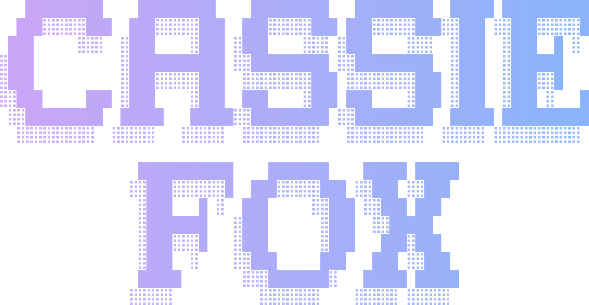

## 🦊 Digging through binaries, one burrow at a time

I find bugs in reverse-engineering tools by running them for real on one Linux box. A crafted ELF file that hung a parser for two minutes. An upper-case header that broke a live session. A new default that would have broken a project's own check scripts. Most of it is on [REA](https://github.com/morluto/rea), an open-source tool for reverse engineering with AI agents.

I pick what gets tested, steer the work, and read every result before it goes up. [Claude Code](https://github.com/anthropics/claude-code) does the hands-on part: it runs the tests, reads the binaries and drafts the write-ups. Every post says so in its footer.

I keep a fork of each project I test, so most repos here are forks. Three are my own.

### My own

- [a10e-firmware](https://github.com/CassieFox23/a10e-firmware) (GPL-3.0): Why my locked Galaxy A10e won't take LineageOS. It's my phone, and I asked the questions. Claude read the stock firmware. Scripts and a full write-up, plus [a short version on REA's Discussions](https://github.com/morluto/rea/discussions/7872).
- [tab-a8-firmware](https://github.com/CassieFox23/tab-a8-firmware) (GPL-3.0): The same questions for my Galaxy Tab A8, the tablet that did take LineageOS. A static read of its stock firmware, side by side with the A10e.
- [rea-board](https://github.com/CassieFox23/rea-board) (GPL-3.0): [A board](https://cassiefox23.github.io/rea-board/) of REA's open PRs and issues, sorted by the help each one needs. A script builds it every 3 hours, from public data only.

### What I point Claude at

**[REA](https://github.com/morluto/rea)** (MIT): Reverse engineering with AI agents.
- Linux tests and code reviews on [216 PRs](https://github.com/morluto/rea/pulls?q=is%3Apr+reviewed-by%3ACassieFox23+-author%3ACassieFox23)
- [35 issues filed](https://github.com/morluto/rea/issues?q=is%3Aissue+author%3ACassieFox23), 24 of them bugs
- [6 of my own PRs merged](https://github.com/morluto/rea/pulls?q=is%3Apr+author%3ACassieFox23+is%3Amerged), all small

**[rsleigh](https://github.com/ShaneBreazeale/rsleigh)** (Apache-2.0): A decompiler workbench in Rust.
- [Made its output the same every run](https://github.com/ShaneBreazeale/rsleigh/pull/8)
- [Recovered two `ls` jump tables](https://github.com/ShaneBreazeale/rsleigh/pull/14)
- [3 bug reports](https://github.com/ShaneBreazeale/rsleigh/issues?q=is%3Aissue+author%3ACassieFox23)

**[kuna](https://github.com/Noelo-Lab/kuna)** (Apache-2.0): A decompiler built for agents, in Rust.
- Speed and memory tests on big binaries
- [2 bug reports](https://github.com/Noelo-Lab/kuna/issues?q=is%3Aissue+author%3ACassieFox23)

**[blueprint](https://github.com/intincrab/blueprint)** (MIT): Animated diagrams from Claude Code.
- [Captions stay up long enough to read](https://github.com/intincrab/blueprint/pull/3), merged
- [A Fedora 44 test report](https://github.com/intincrab/blueprint/issues/1)

**[anur-living-map](https://github.com/HiAnur/anur-living-map)** (MIT): Claude Code plans a feature on a map, and the team signs off.
- [A security advisory](https://github.com/HiAnur/anur-living-map/security/advisories/GHSA-5chw-xqwq-f7jh): side chats could read the whole home folder. Low severity
- [The fix](https://github.com/HiAnur/anur-living-map/pull/407) shipped with me as co-author
- [4 issues](https://github.com/HiAnur/anur-living-map/issues?q=is%3Aissue+author%3ACassieFox23), all closed

**[halorim](https://github.com/Ferhatmedtahar/halorim)** (MIT): A live wallpaper, a logo that glows along its edge.
- [1 bug report](https://github.com/Ferhatmedtahar/halorim/issues/12): the docs said too much about Wayland, and the image tests wrote over their own PNGs. Both fixed

Counts as of 20 Nov 2026.

### Also forked

- [audio.cpp](https://github.com/0xShug0/audio.cpp) (Apache-2.0): Speech and audio models in pure C++. Forked to test on Linux.
- [abtop](https://github.com/graykode/abtop) (MIT): A monitor for AI coding agents.
- [lot-map](https://github.com/alexeyw/lot-map) (MIT): A live map of what Claude Code is doing.

Forks I'm trying out. Nothing from me has gone upstream in these yet.

### How the testing works

1. Claude reads the diff.
2. It gets a real run on my box: the build, the tests, and the thing the PR says it fixes.
3. The result goes on the PR as a comment or a review: what ran, with exit codes, what didn't, and the box it ran on.
4. Every post ends with a footer saying what the AI did and that I OK'd it.

By 20 Nov 2026 I had commented on [615 PRs](https://github.com/morluto/rea/pulls?q=is%3Apr+commenter%3ACassieFox23+-author%3ACassieFox23) on REA. [194 have merged](https://github.com/morluto/rea/pulls?q=is%3Apr+commenter%3ACassieFox23+-author%3ACassieFox23+is%3Amerged), and [171 are still open](https://github.com/morluto/rea/pulls?q=is%3Apr+commenter%3ACassieFox23+-author%3ACassieFox23+is%3Aopen).

### Code reviews

Many of the reviews check what the review bots claimed, on a real box. For example, three of [the 216 PRs](https://github.com/morluto/rea/pulls?q=is%3Apr+reviewed-by%3ACassieFox23+-author%3ACassieFox23) where a review caught something before merge:

- [Claude re-checked all 35 bot review threads](https://github.com/morluto/rea/pull/4955#pullrequestreview-5566282834). The author had marked 33 as fixed, and those fixes held. One real gap was left. Claude also found a new bug: an upper-case Accept header broke the live session. It was fixed within half an hour.
- [A bot said a new default would break REA's own check scripts](https://github.com/morluto/rea/pull/5660#pullrequestreview-5594834134). Claude replayed the scripts' checks, and they failed. The scripts were fixed before merge.
- [A crafted ELF file hung the parser for up to 112 seconds](https://github.com/morluto/rea/pull/4837#pullrequestreview-5565089182). The parser still reported the parse as complete. Fixed and retested.

### Write-ups

- [Start here: REA's trackers and my test queue](https://github.com/morluto/rea/discussions/10401): A map of REA's trackers and triage, and my Linux test queue.
- [REA on Fedora-based Linux](https://github.com/morluto/rea/discussions/1435): Setup notes and gotchas.
- [Benchmarks](https://github.com/morluto/rea/discussions/1998): REA's startup time on Node 22, 24 and 26, plus five local models compared.
- [My local model setup](https://github.com/morluto/rea/discussions/2006): Free local models reading REA's output on one 12 GB GPU.
- [Local models can drive REA over MCP](https://github.com/morluto/rea/discussions/3098): A small test, with about 10 tools in view. A 27B model got it right 3 of 3 times, and a 35B model 4 of 5. Too few runs to call it a result.
- [kuna, rsleigh and Ghidra on the same three files](https://github.com/morluto/rea/discussions/3858): First speed results, side by side.

### My test bench

| Part | What |
|---|---|
| OS | Nobara Linux 44 (Fedora-based) |
| CPU | Ryzen 9 5900X |
| RAM | 32 GB |
| GPU | Radeon RX 6700 XT, 12 GB |
| Node | 22, 24 and 26 |
| Ghidra | 12.2 (Apache-2.0) |
| Local models | llama.cpp (MIT) |
