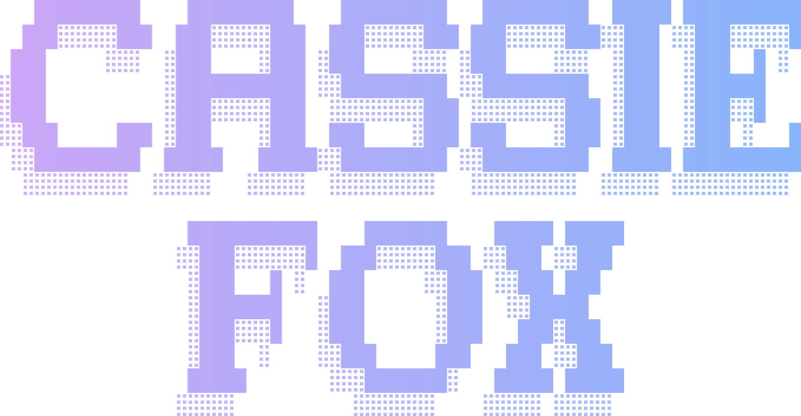

## 🦊 Digging through binaries, one burrow at a time

Hobbyist on one Linux box, with a few too many reverse-engineering tools. [Claude Code](https://github.com/anthropics/claude-code) does the hands-on work. It runs the tests, does the reverse engineering and drafts the write-ups. I pick what it looks at, steer it, and read every result before it goes up.

Mostly I point it at other people's projects, so most repos here are forks. One is my own.

### My own

[a10e-firmware](https://github.com/CassieFox23/a10e-firmware) (GPL-3.0): Why my locked Galaxy A10e won't take LineageOS. It's my phone, and I asked the questions. Claude read the stock firmware. Scripts and a full write-up, plus [a short version on REA's Discussions](https://github.com/morluto/rea/discussions/7872).

### What I point Claude at

| Project | What it is | What came of it |
|---|---|---|
| [REA](https://github.com/morluto/rea) (MIT) | Reverse engineering with AI agents | Linux tests and code reviews on [216 PRs](https://github.com/morluto/rea/pulls?q=is%3Apr+reviewed-by%3ACassieFox23+-author%3ACassieFox23). [35 issues filed](https://github.com/morluto/rea/issues?q=is%3Aissue+author%3ACassieFox23), 24 of them bugs. [6 of my own PRs merged](https://github.com/morluto/rea/pulls?q=is%3Apr+author%3ACassieFox23+is%3Amerged), like [website dark mode](https://github.com/morluto/rea/pull/1894) and [an Electron launch fix](https://github.com/morluto/rea/pull/2705) |
| [rsleigh](https://github.com/ShaneBreazeale/rsleigh) (Apache-2.0) | A decompiler workbench in Rust | [Made output the same every run](https://github.com/ShaneBreazeale/rsleigh/pull/8). [Recovered two `ls` jump tables](https://github.com/ShaneBreazeale/rsleigh/pull/14). [2 bug reports](https://github.com/ShaneBreazeale/rsleigh/issues?q=is%3Aissue+author%3ACassieFox23) |
| [kuna](https://github.com/Noelo-Lab/kuna) (Apache-2.0) | A decompiler built for agents, in Rust | Speed and memory tests on big binaries. [2 bug reports](https://github.com/Noelo-Lab/kuna/issues?q=is%3Aissue+author%3ACassieFox23) |

Counts as of 11 Nov 2026.

### Also forked

- [audio.cpp](https://github.com/0xShug0/audio.cpp) (Apache-2.0): Speech and audio models in pure C++. Forked to test on Linux.
- [abtop](https://github.com/graykode/abtop) (MIT): A monitor for AI coding agents.
- [lot-map](https://github.com/alexeyw/lot-map) (MIT): A live map of what Claude Code is doing.

Nothing of mine is in them yet.

### How the testing works

Claude reads the diff first. Then it gets a real run on my box: the build, the tests, and the thing the PR says it fixes. The result goes on the PR as a comment or a review: what ran, with exit codes, what didn't, and the box it ran on. Every post ends with a footer saying what the AI did and that I OK'd it.

By 8 Nov 2026, [95 PRs Claude tested or wrote](https://github.com/morluto/rea/discussions/1435#discussioncomment-18855005) had merged on REA.

### Code reviews

Many of the reviews check what the review bots claimed, on a real box. Three of [the 216 PRs](https://github.com/morluto/rea/pulls?q=is%3Apr+reviewed-by%3ACassieFox23+-author%3ACassieFox23) that caught something before merge:

- [34 of 35 bot findings didn't reproduce](https://github.com/morluto/rea/pull/4955#pullrequestreview-5566282834). Claude found a new bug instead: an upper-case Accept header broke the live session. It was fixed within half an hour.
- [A bot said a new default would break REA's own check scripts](https://github.com/morluto/rea/pull/5660#pullrequestreview-5594834134). Claude replayed the scripts' checks, and they failed. The scripts were fixed before merge.
- [A crafted ELF file hung the parser for up to 112 seconds](https://github.com/morluto/rea/pull/4837#pullrequestreview-5565089182). It still said the parse was complete. Fixed and retested.

### Write-ups

- [REA on Fedora-based Linux](https://github.com/morluto/rea/discussions/1435): Setup notes, gotchas and my test queue.
- [Benchmarks](https://github.com/morluto/rea/discussions/1998): REA's startup time on Node 22, 24 and 26, plus five local models compared.
- [My local model setup](https://github.com/morluto/rea/discussions/2006): Free local models reading REA's output on one 12 GB GPU.
- [Local models can drive REA over MCP](https://github.com/morluto/rea/discussions/3098): With about 10 tools showing, the right answer 3 of 3 times on a 27B model and 4 of 5 on a 35B.
- [kuna, rsleigh and Ghidra on the same three files](https://github.com/morluto/rea/discussions/3858): First speed results, side by side.

My test bench: Nobara Linux 44 (Fedora-based), Ryzen 9 5900X, 32 GB RAM, Radeon RX 6700 XT 12 GB. Node 22, 24 and 26, Ghidra 12.1.4 (Apache-2.0), and local models in llama.cpp (MIT).
